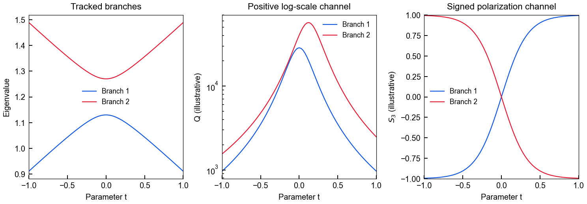
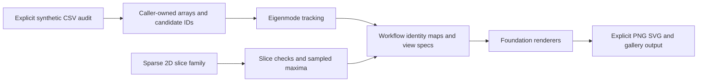
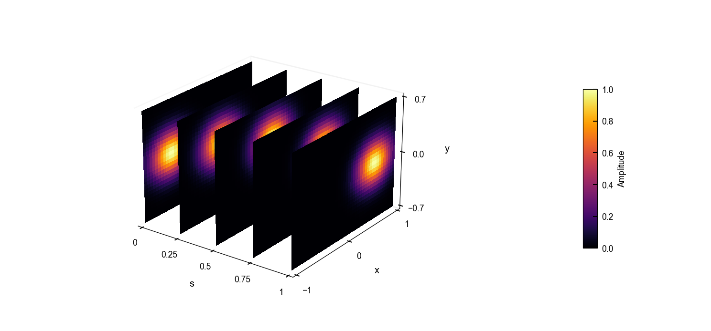
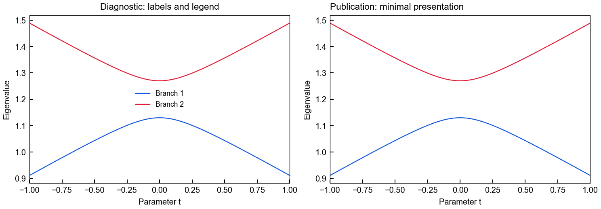
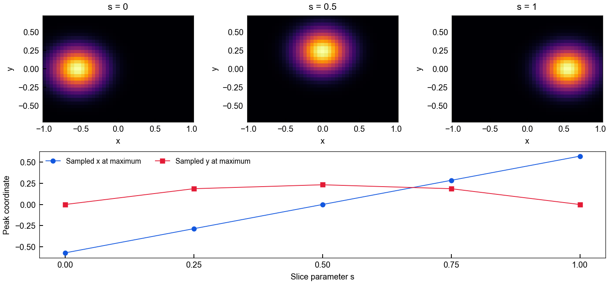

# Plot Workflows

[English](README.md) · [简体中文](README.zh-CN.md) · [Computed gallery](docs/assets/showcase/gallery.html) · [Public API](docs/public-api.md)

Turn candidate arrays into tracked plot families and sparse-slice views. `plot-workflows` composes the numerical contracts of Eigenmode Analysis with the typed renderers of Plot Foundation, while callers retain data formats, scientific interpretation and output ownership. **Version 0.1.7 · Python 3.10+.**



The three panels share the same synthetic parameter path and branch colors. **Q and S3 are independently defined example channels**, not derived from the eigenvalues. [Runnable source](examples/synthetic_end_to_end.py) · [Provenance and checks](docs/assets/showcase/manifest.json).

## Reusable orchestration

| Capability | Public interface |
|---|---|
| Tracking with identity maps and runtime provenance | `run_path_workflow`, `run_graph_workflow`, `run_surface_workflow` |
| Consistent band/quantity views | `band_plot_spec_from_payloads`, `render_band_payloads` |
| Surface composition | `surface_heatmap_spec_from_payload`, `multi_surface_spec_from_payloads` |
| Visualizer lifecycle | Reusable 1D/2D field, band, momentum and polarization Visualizers |
| Sparse 2D slice families | `SliceDataset`, `inspect_slice_series`, `find_extrema_trajectory`, `plot_heatmap_slices_3d` |
| Optional batch composition | SVG/PNG batch helpers and explicit caller hooks |



The audit is a separate caller step, not a dependency of numerical tracking. Readers, language-specific schemas, manifests, filenames and persistence belong to callers.

## Compatible release set

| Distribution | Example version | Constraint |
|---|---|---|
| eigenmode-analysis | **0.2.10** | Workflows requires `>=0.2.10,<0.3`; the separate 0.3.1 grouping line is incompatible |
| plot-foundation | **0.1.13** | Workflows requires `>=0.1.12,<0.2` |
| plot-workflows | **0.1.7** | This public API |
| campaign-data | **0.2.0** | Independent file-audit stage; do **not** select Workflows' `[campaign]` extra, which pins `<0.2` |

The example also pins **Matplotlib 3.10.9**: Workflows 0.1.7 still uses `matplotlib.cm.get_cmap`, which was removed in 3.11. The current package metadata does not impose this upper bound, so use the example requirements for this release. This is an existing compatibility limitation, not an API change in this documentation update.

The `[multislice]` extra adds pandas, Matplotlib and SciPy. The `[batch]` extra adds pandas, svgutils and Pillow for batch helpers. Core import does not load the optional multislice module.

## Run the end-to-end example

From this repository, use Python 3.10+, Git and a fresh virtual environment:

```bash
python -m venv .venv
# Activate .venv for your shell, then:
python -m pip install -r examples/requirements-showcase.txt
python -m pip check
python examples/synthetic_end_to_end.py --out docs/assets/showcase
```

[The requirements file](examples/requirements-showcase.txt) pins verified public Git revisions for all four libraries; it does not assume package-index availability or uncreated tags. Equivalent verified wheels with the versions above can be used. Install Workflows with its `[multislice]` wheel extra so the optional dependencies are resolved. Production environments should use installed wheels, not sibling-source injection.

The script generates its own 11/12-point CSV, audits it read-only, tracks shuffled branch candidates, builds a band/Q/S3 figure family, compares presentation profiles, and analyzes five sparse Gaussian slices. It writes four PNG/SVG pairs, an offline gallery, the actual audit report, sampled-maxima CSV and a source/version/hash manifest. Assertions verify source-byte preservation, expected tracking, identical profile arrays, x/y orientation and maxima within half a grid step of the analytic centers.

## Minimal public workflow

```python
from plot_workflows import CandidateSet, run_path_workflow, band_plot_spec_from_payloads
from plot_foundation import render_line_plot

points = [
    CandidateSet(["a", "b"], [[1.0], [2.0]]),
    CandidateSet(["d", "c"], [[2.1], [1.1]]),
]
tracked = run_path_workflow(points, [0, 1])
payloads = {"track 1": {"x": [0, 1], "y": tracked.result.features[:, 0, 0]}}
spec = band_plot_spec_from_payloads(
    payloads, title="Synthetic path", ylabel="Eigenvalue", is_tracked=True,
)
rendered = render_line_plot(spec)  # Caller chooses saving and closing.
```

## Data space before visualization

A surface renderer consumes 2D data; it does not imply dense 3D sampling. Five 2D grids form a **quasi-3D slice family**, not a volume. A sampled maximum per slice is a derived 1D trajectory and does not automatically identify a physical mode.



| Presentation profiles | Raw slices and sampled maxima |
|---|---|
|  |  |

Foundation grid specs and `SliceDataset` use x-first arrays: `(len(x),len(y))`. The historical workflow **surface payload adapter** explicitly consumes y-first `(len(y),len(x))` arrays and transposes them once into foundation specs; the example tests this boundary using a non-square grid.

Read [Data Space and Visualization Views](docs/data-space-and-visualization.md) before choosing a pipeline. Its seven-field decision record separates raw sampling, transformations, derived quantities and selected views. The generated manifest includes this record.

## Style and documentation

[Public API](docs/public-api.md) · [Profile adaptation](docs/phase-04-style-profiles.md) · [Canonical figure-delivery policy](https://github.com/Patr1ck2005/plot-foundation/blob/public-release/docs/style-policy.md#a4-paper-delivery) · [Changelog](CHANGELOG.md) · [Agent rules](AGENTS.md).

`diagnostic` and `publication_minimal` affect presentation through foundation specs. Callers still choose physical aspect, limits, normalization, colormaps, labels and export geometry. The gallery uses explicit 180 DPI fixed-canvas previews; it restores essential labels on standalone minimal panels and records actual dimensions. Scientific meaning remains in the owning consumer project.

For development, use an isolated environment, install `.[dev,multislice]` with compatible shared-library wheels, and run `python -m pytest -q`. Add `[batch]` when testing batch functionality. Example assertions are focused checks, not the complete suite.

[Original concept artwork](docs/assets/portfolio/scientific-tools-research-v2.png) and [artwork provenance](docs/assets/portfolio/manifest.json) remain auxiliary illustrations. MIT licensed. All showcase data are independent synthetic mathematics; no private research artifacts are used.
