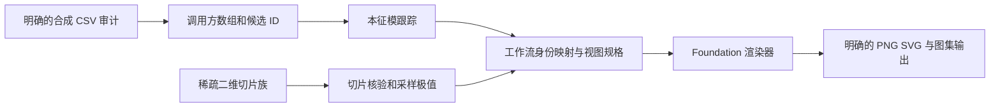

# Plot Workflows

[English](README.md) · [简体中文](README.zh-CN.md) · [实际生成的图集](docs/assets/showcase/gallery.html) · [公开 API](docs/public-api.md)

将候选数组编排为跟踪图族和稀疏切片视图。`plot-workflows` 组合 Eigenmode Analysis 的数值合同与 Plot Foundation 的类型化渲染器，调用方保留数据格式、科学解释和输出归属。**版本 0.1.7 · Python 3.10+。**


三图共享同一合成参数路径和分支颜色。**Q 与 S3 是独立定义的示例通道**，并非从本征值推得。[可运行源码](examples/synthetic_end_to_end.py) · [来源与检查记录](docs/assets/showcase/manifest.json)。

## 可复用编排能力

| 能力 | 公开接口 |
|---|---|
| 带身份映射和运行来源的跟踪 | `run_path_workflow`、`run_graph_workflow`、`run_surface_workflow` |
| 一致的能带／物理量视图 | `band_plot_spec_from_payloads`、`render_band_payloads` |
| 曲面组合 | `surface_heatmap_spec_from_payload`、`multi_surface_spec_from_payloads` |
| Visualizer 生命周期 | 一维／二维场、能带、动量和偏振 Visualizer |
| 稀疏二维切片族 | `SliceDataset`、`inspect_slice_series`、`find_extrema_trajectory`、`plot_heatmap_slices_3d` |
| 可选批量组合 | SVG／PNG 批量工具及明确的调用方 hooks |



文件审计是调用方的独立步骤，不是数值跟踪的依赖。读取、语言相关 schema、manifest、文件名与持久化由调用方负责。

## 兼容版本组合

| 发行包 | 示例版本 | 约束 |
|---|---|---|
| eigenmode-analysis | **0.2.10** | Workflows 要求 `>=0.2.10,<0.3`；独立 0.3.1 分组线不兼容 |
| plot-foundation | **0.1.13** | Workflows 要求 `>=0.1.12,<0.2` |
| plot-workflows | **0.1.7** | 本公开 API |
| campaign-data | **0.2.0** | 独立文件审计；**不要**选择 Workflows 的 `[campaign]` extra，其要求 `<0.2` |

示例还固定 **Matplotlib 3.10.9**：Workflows 0.1.7 使用的 `matplotlib.cm.get_cmap` 已在 3.11 移除。当前包元数据没有该上限，因此此发行版请使用示例依赖文件。这是现有兼容限制，本次文档更新不修改生产 API。

`[multislice]` extra 增加 pandas、Matplotlib 和 SciPy。`[batch]` extra 为批量工具增加 pandas、svgutils 和 Pillow。导入核心包不会加载可选 multislice 模块。

## 运行端到端示例

在本仓库使用 Python 3.10+、Git 与新的虚拟环境：

```bash
python -m venv .venv
# 按当前 shell 的方法激活 .venv，然后执行：
python -m pip install -r examples/requirements-showcase.txt
python -m pip check
python examples/synthetic_end_to_end.py --out docs/assets/showcase
```

[依赖文件](examples/requirements-showcase.txt)将四库固定到已核对的公开 Git 版本，不假定包索引可用或已有版本标签。也可以使用上表版本的核验 wheel。安装 Workflows wheel 时选 `[multislice]` extra，以解析可选依赖。生产环境使用安装后的 wheel，不注入兄弟仓库源码。

脚本自行生成 11／12 点 CSV，只读审计，跟踪乱序候选，创建能带／Q／S3 图族，对比展示 profile，并分析五张稀疏 Gaussian 切片。输出四组 PNG／SVG、离线图集、真实审计报告、采样极值 CSV 和源码／版本／哈希 manifest。断言核验原始字节不变、预期轨迹、两种 profile 数组一致、x／y 方向，以及极值距解析中心不超过半个网格步长。

## 最小公开工作流

```python
from plot_workflows import CandidateSet, run_path_workflow, band_plot_spec_from_payloads
from plot_foundation import render_line_plot

points = [
    CandidateSet(["a", "b"], [[1.0], [2.0]]),
    CandidateSet(["d", "c"], [[2.1], [1.1]]),
]
tracked = run_path_workflow(points, [0, 1])
payloads = {"track 1": {"x": [0, 1], "y": tracked.result.features[:, 0, 0]}}
spec = band_plot_spec_from_payloads(
    payloads, title="Synthetic path", ylabel="Eigenvalue", is_tracked=True,
)
rendered = render_line_plot(spec)  # 调用方选择保存与关闭。
```

## 先判断数据空间，再选择视图

曲面渲染器消费二维数据，不代表稠密三维采样。五张二维网格构成**准三维切片族**，不是体数据。每张切片的一个采样最大值构成派生一维轨迹，不自动等于物理模式身份。


| 展示 profile | 原始切片与采样极值 |
|---|---|
|  |  |

Foundation 网格规格与 `SliceDataset` 使用 x-first：`(len(x),len(y))`。历史工作流的**曲面 payload 适配器**明确消费 y-first 的 `(len(y),len(x))`，再转置一次进入 foundation 规格；示例使用非方形网格验证该边界。

选择管线前请阅读 [Data Space and Visualization Views](docs/data-space-and-visualization.md)。其七项决策记录区分原始采样、变换、派生量和所选视图；生成的 manifest 包含该记录。

## 样式与文档

[公开 API](docs/public-api.md) · [Profile 适配](docs/phase-04-style-profiles.md) · [权威图稿交付规范](https://github.com/Patr1ck2005/plot-foundation/blob/public-release/docs/style-policy.md#a4-paper-delivery) · [变更记录](CHANGELOG.md) · [Agent 规则](AGENTS.md)。

`diagnostic` 与 `publication_minimal` 通过 foundation 规格影响展示。物理纵横比、范围、归一化、色图、标签和导出几何仍由调用方决定。图集采用明确的固定画布 180 DPI 预览，为独立极简面板恢复必要标签，并记录实际尺寸。科学含义留在所属消费端课题。

开发时在隔离环境安装 `.[dev,multislice]` 及兼容共享库 wheel，运行 `python -m pytest -q`。测试批量功能时另加 `[batch]`。示例断言为针对性检查，不替代完整测试。

[原概念图](docs/assets/portfolio/scientific-tools-research-v2.png)和[来源记录](docs/assets/portfolio/manifest.json)保留为辅助示意。采用 MIT 许可证。图集全部来自独立合成数学定义，未使用私人研究产物。
